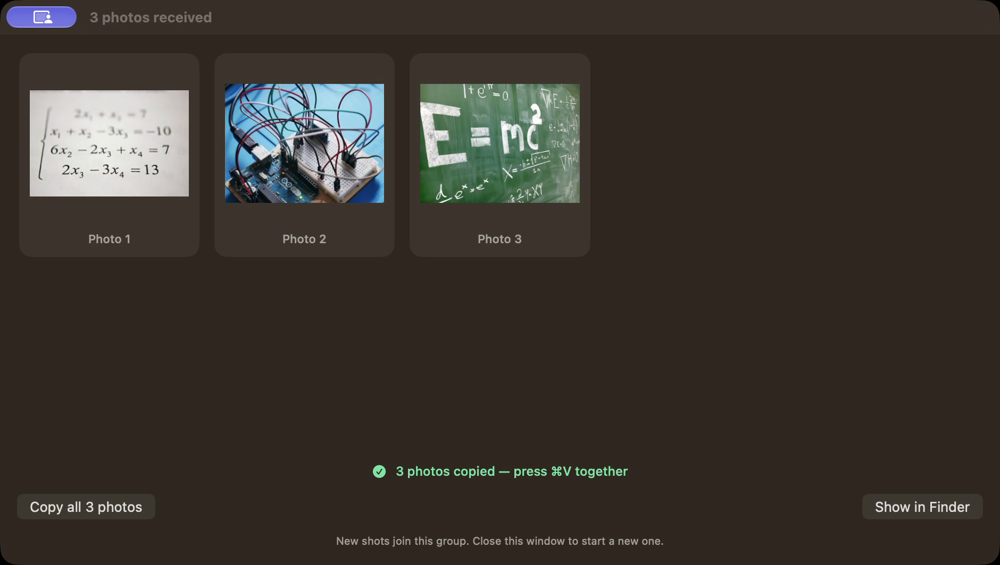

# ShotSkiff

**From your iPhone. Straight to your Mac.**

Take an iPhone screenshot or photo and use it on your Mac right away. The Mac receiver previews images above your current app, copies them to the clipboard, and groups successive photos for batch use. Free and open source under MIT; no account or cloud upload.

## Download for Mac

**[Download ShotSkiff for Apple Silicon Macs](https://github.com/huj28-creator/SnapBridge/releases/download/v0.1.0/ShotSkiff-macOS-v0.1.0.dmg)** · [SHA-256](https://github.com/huj28-creator/SnapBridge/releases/download/v0.1.0/ShotSkiff-macOS-v0.1.0.dmg.sha256) · [Release notes](https://github.com/huj28-creator/SnapBridge/releases/tag/v0.1.0)

Requirements: macOS 14 or later and Apple Silicon. The Mac app is ad-hoc signed, not notarized; macOS may require Control-click → Open. Never disable Gatekeeper or SIP. See the [beginner Mac guide](docs/install-mac.md).

## Pick a workflow

### Automatic screenshots — easiest

Install the Mac app, connect and trust your iPhone once, choose it in ShotSkiff, and enable screenshot importing. Use the normal iPhone screenshot buttons; new screenshots appear in the Mac popup. No custom iPhone app or Xcode is needed. Screenshot import requires Python 3 and Homebrew `libimobiledevice`; the Mac setup explains and asks before installing the latter. Initial trust is easiest over USB; a previously trusted Wi-Fi device connection may work when available.

### Camera photos + screenshots — advanced

The optional native iPhone companion captures full-resolution photos and sends them over encrypted local transfer. It requires Xcode and signing with your own free Apple Personal Team. Free provisioning expires after seven days. An optional Mac renewal helper may refresh it if Xcode, the signing identity, Apple services, and a reachable paired phone all cooperate; it cannot silently accept iOS trust prompts and is not guaranteed. See the [iPhone setup guide](docs/install-iphone.md) and [renewal details](docs/renewal.md).

## What it does

- Floating preview above your current Mac app, with copy and drag support.
- Grouped burst photos with individual previews and batch clipboard files; destination apps set their own attachment limits and paste support.
- Original camera JPEGs preserved byte for byte, including embedded metadata. Location can remain if recorded by the camera.
- Screenshot PNGs read from the selected trusted device without importing the existing library.
- Mac inbox keeps at most 20 app-managed images and permanently removes the oldest; export anything you want to keep.
- No telemetry, account, ads, subscription, or product cloud service.

## Demo



The receiver capture is from the previous SnapBridge-branded build; functionality is the same as ShotSkiff. Three Chinese demo cuts (15, 30, and 46 seconds) are on the [public product site](https://huj28-creator.github.io/SnapBridge/), with English and Chinese captions. The phone footage uses an iOS simulator and sample photos; Mac receiver and clipboard footage was recorded locally, so the video is not a real-device speed benchmark. See [photo, music, voice, and production credits](docs/marketing/videos-and-credits.md).

## Privacy and safety

Photos stay on the devices and the local Mac inbox. Automatic receipt replaces the Mac clipboard. Camera metadata, potentially including location, is preserved. See [PRIVACY.md](PRIVACY.md), [SECURITY.md](SECURITY.md), and [uninstall instructions](docs/uninstall.md).

## Development

Requirements: Xcode, Swift toolchain, Python 3. Run tests:

```sh
swift test --package-path .
python3 scripts/test_clipboard.py
python3 scripts/test_renewal.py
```

Regenerate the Xcode project after changing source membership:

```sh
python3 scripts/generate_project.py
```

Build an Apple Silicon Mac DMG from source:

```sh
scripts/build-release-mac.sh 0.1.0 arm64
scripts/verify-release.sh
```

The Mac binary is ad-hoc signed and not notarized. Do not put signing keys, `Local.xcconfig`, pairing information, phone identifiers, photos, or provisioning profiles in Git. The public build does not contain a personal signing identity.

## Contributing and support

See [CONTRIBUTING.md](CONTRIBUTING.md) and [SUPPORT.md](SUPPORT.md). [Open an issue](https://github.com/huj28-creator/SnapBridge/issues) for bugs or setup trouble; do not attach private photos, account data, device IDs, or pairing codes.

## 中文

**手机拍，电脑接。截图、照片，一步到位。**

在 iPhone 上正常截图，或用可选相机伴侣拍照，图片会出现在 Mac 浮窗里，可直接复制、粘贴或拖动。连续收到的图片会自动整理成一组。免费开源，不用注册账号，也不上传云端。

- [下载 Apple 芯片 Mac 版](https://github.com/huj28-creator/SnapBridge/releases/download/v0.1.0/ShotSkiff-macOS-v0.1.0.dmg)（macOS 14+）
- [Mac 截图安装指南](docs/install-mac-zh.md)：普通截图按键即可；需信任 iPhone，并安装 Python 3 与 Homebrew `libimobiledevice`。
- [iPhone 相机伴侣指南](docs/install-iphone-zh.md)：可选；需要 Xcode 和免费个人团队签名，七天到期限制仍然存在。
- Mac 最多保留 20 张应用管理的图片；超出后永久删除最旧的图片。照片只在本地设备之间传输。

仓库地址保留历史名称 SnapBridge 以免旧链接失效；新产品名为 ShotSkiff。查看 [更新记录](CHANGELOG.md) 和 [MIT 许可](LICENSE)。
